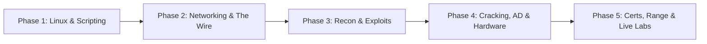

# Master Blueprint: David Bombal vs. NetworkChuck OffSec Curriculum
**Domain:** Offensive Security (S.P.E.A.R. / V.E.C.T.O.R.)  
**Subject:** Palm (Archon.Myth) — Computer Engineering @ SUT  
**Reference Playlists:** 6 David Bombal Playlists + 4 NetworkChuck Playlists + Extended Creator Catalogs  
**Status:** Canonical Reference & Execution Roadmap (Clean Layout & Direct Links)  

---

## 1. Executive Summary & Strategic Framework

ในเส้นทางการฝึกฝนด้าน Offensive Security (OffSec) การมี Resource ที่ยอดเยี่ยมเป็นเพียงครึ่งหนึ่งของสมการ อีกครึ่งหนึ่งคือ **"การจัดลำดับการเรียนรู้ (Sequencing) และการดึงจุดเด่นของแต่ละผู้สอนมาผสานกัน (Synergy)"**

David Bombal และ NetworkChuck เป็นสองเสาหลักที่ทรงอิทธิพลที่สุดในวงการ IT/Cybersecurity บน YouTube แต่ทั้งคู่มี **Pedagogical Archetype (รูปแบบการสอน)** และ **Technical Depth** ที่แตกต่างกันอย่างสิ้นเชิง:

```
[NetworkChuck]                                         [David Bombal]
The Catalyst / Storyteller                             The Engineer / Packet Mechanic
High Energy · Fast Dopamine · Concept Spark            Low-Level Depth · RFC/Packet Traces · Industrial Tradecraft
"ทำตามได้ใน 10 นาที เข้าใจภาพใหญ่ทันที"                  "ผ่าดูระดับ Byte, Packet, และ Kernel internals"
          │                                                       │
          └───────────────────────────┬───────────────────────────┘
                                      ▼
                      [Integrated Hybrid Synergy]
                 NetworkChuck สร้างความเร็วและความเข้าใจเบื้องต้น (Sprint)
                                      +
                 David Bombal ขุดรากฐานลึกจนเป็นวิศวกรตัวจริง (Anchor)
```

### การจัดวางให้สอดคล้องกับ Operator Profile (Palm - Archon.Myth)
- **สถานะ:** นักศึกษา Computer Engineering มทส. (SUT) ผู้มีพื้นฐาน Logic และ Causal thinking แข็งแกร่ง
- **Mindset:** Craftsman Archetype — ไม่ได้เรียนเพื่อเป็น Script Kiddie แต่ต้องการเข้าใจระบบทะลุปรุโปร่ง ("Understand → Experiment → Apply")
- **Feynman Standard:** ต้องเข้าใจถึงขั้นอธิบายกลไกได้โดยไม่ต้องเปิดตำรา และลงมือปฏิบัติได้คล่องแคล่ว
- **ตารางฝึกซ้อมใน ARCHONOS:** รองรับ OffSec Block ประจำวัน (07:00 Deep Theory และ 13:00 Hands-on Exploitation)

---

## 2. วิเคราะห์เจาะลึก 10 Playlists (Specified by User)

### ส่วนที่ 1: David Bombal (6 Playlists)

#### 1.1 Linux Basics for Hacker
- **Playlist URL:** [David Bombal - Linux Basics for Hacker](https://youtube.com/playlist?list=PLhfrWIlLOoKOs-fjCPHdzD2icF2vORfwK)
- **แกนหลักของเนื้อหา:** สร้างขึ้นโดยอิงจากหนังสือระดับตำนาน *"Linux Basics for Hackers"* โดย OccupyTheWeb (OTW) ซึ่ง OTW มาร่วมสอนในหลายคลิป
- **ขอบเขตเนื้อหา:**
  - Linux Directory Hierarchy (`/bin`, `/sbin`, `/etc`, `/dev`, `/proc`, `/var`)
  - File Permissions & Ownership (Octal notation, UGO, SUID/SGID, Sticky Bit)
  - Text Manipulation (`grep`, `sed`, `awk`, `cut`, `sort`, `uniq`)
  - Network Configuration (`ip`, `ifconfig`, routing, DNS config ใน `/etc/resolv.conf`)
  - Process Management, Daemons, Cron jobs, และ Loadable Kernel Modules (LKM)
  - Bash scripting พื้นฐานสำหรับการสแกนและ Automate งาน OffSec
- **วิดีโอสำคัญในเพลย์ลิสต์นี้:**
  - EP 1: [Linux for Hackers Tutorial (And Free Courses)](https://www.youtube.com/watch?v=YJUVNlmIO6E&list=PLhfrWIlLOoKOs-fjCPHdzD2icF2vORfwK)
  - EP 2: [Linux for Hackers Tutorial with OTW! (Episode 2)](https://www.youtube.com/watch?v=8z-s5KQ9DbI&list=PLhfrWIlLOoKOs-fjCPHdzD2icF2vORfwK)
  - EP 3: [Linux Networking that you need to know (Episode 3)](https://www.youtube.com/watch?v=t96iOUxC27M&list=PLhfrWIlLOoKOs-fjCPHdzD2icF2vORfwK)
  - EP 4: [Linux for Hackers Python pip, Git, Apt NEW Tools Install with OTW!](https://www.youtube.com/watch?v=EeGjmTx2diM&list=PLhfrWIlLOoKOs-fjCPHdzD2icF2vORfwK)
  - EP 5: [Did you know this about Linux? // Linux for Hackers Ep 5](https://www.youtube.com/watch?v=nbznYEAdZfk&list=PLhfrWIlLOoKOs-fjCPHdzD2icF2vORfwK)
  - EP 6: [Linux for Hackers: LINUX commands you need to know (with OTW)](https://www.youtube.com/watch?v=DiGangfhJ4g&list=PLhfrWIlLOoKOs-fjCPHdzD2icF2vORfwK)
- **Verdict & Role:** **"Foundational Anchor"** — เป็นคอร์สแกนหลักที่ต้องดูเพื่อความแน่นของ Linux internals

#### 1.2 Hashcat Course
- **Playlist URL:** [David Bombal - Hashcat Course](https://youtube.com/playlist?list=PLhfrWIlLOoKNhibrzUPCfEnW4_EHWQBrA)
- **แกนหลักของเนื้อหา:** การแคร็กรหัสผ่านด้วย Hashcat โดยใช้ GPU Acceleration อย่างเต็มประสิทธิภาพ
- **ขอบเขตเนื้อหา:**
  - สถาปัตยกรรม Hashcat และกลไก GPU Compute (OpenCL / CUDA)
  - การระบุประเภท Hash (`hashid`, Hashcat modes: `-m 0` MD5, `-m 1000` NTLM, `-m 22000` WPA-PBKDF2)
  - Attack Modes: Dictionary Attack (`-a 0`), Combinator (`-a 1`), Brute-force / Mask Attack (`-a 3`), Hybrid Attack (`-a 6`, `-a 7`)
  - การใช้ Rule-based Cracking (เช่น `OneRuleToRuleThemAll`, `best64.rule`)
  - การแคปเจอร์และแปลง WPA/WPA2 PMKID / 4-way Handshake ด้วย `hcxdumptool` และ `hcxpcapngtool`
- **วิดีโอสำคัญในเพลย์ลิสต์นี้และวิดีโอเสริม:**
  - Video 1: [Advanced Bruteforce WiFi WPA2 cracking with GPU and Hashcat](https://www.youtube.com/watch?v=yvNKuZqRmJ4&list=PLhfrWIlLOoKNhibrzUPCfEnW4_EHWQBrA)
  - Video 2: [Bruteforce WiFi WPA2 with GPU](https://www.youtube.com/watch?v=b5zQ6xTQGfY&list=PLhfrWIlLOoKNhibrzUPCfEnW4_EHWQBrA)
  - เสริมระดับตำนาน: [16 secs to break it! 70% of real world WiFi networks owned! (Hashcat 22000)](https://www.youtube.com/watch?v=ZTIB9Ki9VtY)
  - เสริมระดับแล็บ: [WiFi WPA/WPA2 vs hashcat and hcxdumptool](https://www.youtube.com/watch?v=Usw0IlGbkC4)
  - เสริม Cloud GPU: [Break WiFi networks using Cloud GPUs in seconds](https://www.youtube.com/watch?v=KupkzhM4z4Y)
- **Verdict & Role:** **"Specialized Weapon"** — เรียนเมื่อเข้าสู่หัวข้อ Credential Access และ Password Cracking

#### 1.3 Ethical Hacking: Getting Started Guide
- **Playlist URL:** [David Bombal - Ethical Hacking Getting Started](https://youtube.com/playlist?list=PLhfrWIlLOoKPqmsoVb0STYzw4IaTe1fxn)
- **แกนหลักของเนื้อหา:** แผนที่นำทาง (Roadmap) และวิธีเริ่มต้นเส้นทางสาย Ethical Hacker จากศูนย์ (222 วิดีโอ)
- **วิดีโอสำคัญที่คัดกรองมาให้:**
  - [2022 Cybersecurity roadmap: How to get started? (feat. John Hammond)](https://www.youtube.com/watch?v=mS7qWC3CbOU&list=PLhfrWIlLOoKPqmsoVb0STYzw4IaTe1fxn)
  - [Ex-NSA hacker tells us how to get into hacking!](https://www.youtube.com/watch?v=SFbV7sTSAlA&list=PLhfrWIlLOoKPqmsoVb0STYzw4IaTe1fxn)
  - [How to get your first Cybersecurity job](https://www.youtube.com/watch?v=EtVTPonfm6Q&list=PLhfrWIlLOoKPqmsoVb0STYzw4IaTe1fxn)
  - [Get a cert, get a hacking job? #CEH #OSCP](https://www.youtube.com/watch?v=nMqRmXO2x3s&list=PLhfrWIlLOoKPqmsoVb0STYzw4IaTe1fxn)
  - [Kali Linux 2020.3 install Windows 10 (for free)](https://www.youtube.com/watch?v=VAMP8DqSDjg&list=PLhfrWIlLOoKPqmsoVb0STYzw4IaTe1fxn)
- **Verdict & Role:** **"Orientation & Strategic Alignment"** — ดูเพื่อปรับทิศทางและจัดระบบความคิด

#### 1.4 CompTIA Security+
- **Playlist URL:** [David Bombal - CompTIA Security+](https://youtube.com/playlist?list=PLhfrWIlLOoKOLvN7wQjSFcqfBlQ0lZwO5)
- **แกนหลักของเนื้อหา:** ประเด็นความปลอดภัยภาคปฏิบัติที่สอดคล้องกับหัวข้อการสอบ CompTIA Security+
- **วิดีโอสำคัญในเพลย์ลิสต์นี้:**
  - [Wait, what? Only 2 seconds to open a safe? (Physical Security)](https://www.youtube.com/watch?v=X990ZNA2Tog&list=PLhfrWIlLOoKOLvN7wQjSFcqfBlQ0lZwO5)
  - [Credit card cloning is too easy! (RFID / NFC Attacks)](https://www.youtube.com/watch?v=eyd24FlJCFg&list=PLhfrWIlLOoKOLvN7wQjSFcqfBlQ0lZwO5)
  - [Python keylogger](https://www.youtube.com/watch?v=XKoTwepEzPI&list=PLhfrWIlLOoKOLvN7wQjSFcqfBlQ0lZwO5)
  - [hydra (Online Password Brute-forcing)](https://www.youtube.com/watch?v=3_f-SWQP3x0&list=PLhfrWIlLOoKOLvN7wQjSFcqfBlQ0lZwO5)
  - [Destroying VNC with Cain and Abel](https://www.youtube.com/watch?v=IaUTKxPpygU&list=PLhfrWIlLOoKOLvN7wQjSFcqfBlQ0lZwO5)
  - [Do you need a Cybersecurity home lab?](https://www.youtube.com/watch?v=fffSbCbafts&list=PLhfrWIlLOoKOLvN7wQjSFcqfBlQ0lZwO5)
  - [Cybersecurity hacking path](https://www.youtube.com/watch?v=yq561bLg10A&list=PLhfrWIlLOoKOLvN7wQjSFcqfBlQ0lZwO5)
- **Verdict & Role:** **"Broad Security Foundation"** — ใช้เติมเต็มคำศัพท์ ทฤษฎีความปลอดภัย และโครงสร้างองค์กร

#### 1.5 Wireshark and Ethical Hacking Course
- **Playlist URL:** [David Bombal - Wireshark & Ethical Hacking](https://youtube.com/playlist?list=PLhfrWIlLOoKMBv50Y8NH6Dtfge_MrHYnl)
- **แกนหลักของเนื้อหา:** การวิเคราะห์ข้อมูล Packet ระดับลึกด้วย Wireshark สำหรับงาน Ethical Hacking (20 วิดีโอ)
- **วิดีโอสำคัญในเพลย์ลิสต์นี้:**
  - Video #0: [Free Wireshark and Ethical Hacking Course: Intro](https://www.youtube.com/watch?v=QXfaGOMT7MY&list=PLhfrWIlLOoKMBv50Y8NH6Dtfge_MrHYnl)
  - Video #4: [Wireshark Display Filters Tutorial](https://www.youtube.com/watch?v=WdBBYosG-YI&list=PLhfrWIlLOoKMBv50Y8NH6Dtfge_MrHYnl)
  - Video #7: [Never use Telnet (Cleartext Password Capture)](https://www.youtube.com/watch?v=nGEKnYUEPcg&list=PLhfrWIlLOoKMBv50Y8NH6Dtfge_MrHYnl)
  - Video #8: [Never use TFTP or FTP! (Credential Sniffing)](https://www.youtube.com/watch?v=PoaOgBmWJQY&list=PLhfrWIlLOoKMBv50Y8NH6Dtfge_MrHYnl)
  - Video #9: [Why are you still using HTTP? (Capturing Web Passwords)](https://www.youtube.com/watch?v=LfZNhf2Yc8k&list=PLhfrWIlLOoKMBv50Y8NH6Dtfge_MrHYnl)
  - Video #11: [Wireshark Tutorial - Installation and Password sniffing](https://www.youtube.com/watch?v=4_7A8Ikp5Cc&list=PLhfrWIlLOoKMBv50Y8NH6Dtfge_MrHYnl)
  - Video #13: [Wireshark Tutorial - Profiles and Password captures](https://www.youtube.com/watch?v=zRk5dymfNsk&list=PLhfrWIlLOoKMBv50Y8NH6Dtfge_MrHYnl)
  - Video #14: [tshark and Termshark tutorial (CLI Packet Capture)](https://www.youtube.com/watch?v=HoYgPlmOZgo&list=PLhfrWIlLOoKMBv50Y8NH6Dtfge_MrHYnl)
  - Video #18: [How TCP really works: Top 3 things you need to know!](https://www.youtube.com/watch?v=Auwn3RWapRE&list=PLhfrWIlLOoKMBv50Y8NH6Dtfge_MrHYnl)
  - Video #19: [Capture and Replay Phone Calls (MITM / VoIP replay)](https://www.youtube.com/watch?v=LoFoV3T17T0&list=PLhfrWIlLOoKMBv50Y8NH6Dtfge_MrHYnl)
  - วิดีโอเจาะลึกเฉพาะทาง (David Bombal):
    - [Kali Linux: Hacking ARP (ARP Poisoning / MITM)](https://www.youtube.com/watch?v=ns7TYxNcYBM)
    - [How TCP really works // Three-way handshake // Deep Dive (feat. Chris Greer)](https://www.youtube.com/watch?v=rmFX1V49K8U)
    - [How Nmap really works // And how to catch it with Wireshark (feat. Chris Greer)](https://www.youtube.com/watch?v=F2PXe_o7KqM)
- **Verdict & Role:** **"The Ultimate Anchor"** — จำเป็นที่สุดสำหรับ Palm ในฐานะนักศึกษาวิศวะคอมพ์

#### 1.6 Kali Linux: Ethical Hacking Getting Started
- **Playlist URL:** [David Bombal - Kali Linux Getting Started](https://youtube.com/playlist?list=PLhfrWIlLOoKMe1Ue0IdeULQvEgCgQ3a1B)
- **แกนหลักของเนื้อหา:** การตั้งค่า Kali Linux และการเริ่มใช้งาน Toolchain พื้นฐานสำหรับการเจาะระบบ (128 วิดีโอ)
- **วิดีโอสำคัญในเพลย์ลิสต์นี้:**
  - [Kali Linux Install: Ethical hacking getting started guide](https://www.youtube.com/watch?v=AnwgxRtWXLI&list=PLhfrWIlLOoKMe1Ue0IdeULQvEgCgQ3a1B)
  - [Kali Linux: Hacking Networks Part 1](https://www.youtube.com/watch?v=K1bMSPje6pw&list=PLhfrWIlLOoKMe1Ue0IdeULQvEgCgQ3a1B)
  - [Kali Linux: Hacking Networks Part 2](https://www.youtube.com/watch?v=U3Wr2gfIUXM&list=PLhfrWIlLOoKMe1Ue0IdeULQvEgCgQ3a1B)
  - [Kali Linux: Hacking DHCP and MITM](https://www.youtube.com/watch?v=g9OGphrEMb0&list=PLhfrWIlLOoKMe1Ue0IdeULQvEgCgQ3a1B)
  - [Kali Linux: Hacking ARP](https://www.youtube.com/watch?v=ns7TYxNcYBM&list=PLhfrWIlLOoKMe1Ue0IdeULQvEgCgQ3a1B)
  - [Dynamic ARP Inspection: Stop Kali Linux ARP poisoning attacks](https://www.youtube.com/watch?v=uKhySSs08tk&list=PLhfrWIlLOoKMe1Ue0IdeULQvEgCgQ3a1B)
  - [Your WiFi is mine! (hak5 omg cable)](https://www.youtube.com/watch?v=QHwPaLChvgw&list=PLhfrWIlLOoKMe1Ue0IdeULQvEgCgQ3a1B)
  - [How I did it (hak5 rubber ducky)](https://www.youtube.com/watch?v=A2JNBpUotZM&list=PLhfrWIlLOoKMe1Ue0IdeULQvEgCgQ3a1B)
  - [Burp Suite Tutorial for Beginners](https://www.youtube.com/watch?v=-CLE7ndoUqE)
  - [Unleashing Metasploit: The Comprehensive Toolkit](https://www.youtube.com/watch?v=GxkKszPVD1M)
- **Verdict & Role:** **"Tool Arsenal Onboarding"** — ใช้เป็นสารานุกรมคำสั่งและการใช้เครื่องมือ

---

### ส่วนที่ 2: NetworkChuck (4 Playlists)

#### 2.1 learn BASH Scripting
- **Playlist URL:** [NetworkChuck - learn BASH Scripting](https://youtube.com/playlist?list=PLIhvC56v63IKioClkSNDjW7iz-6TFvLwS)
- **แกนหลักของเนื้อหา:** คอร์สเรียนเขียน Bash Scripting 5 ตอนที่ยอดเยี่ยมและสร้างความสนุกที่สุดบน YouTube
- **ลิงก์ทุกตอนแบบครบถ้วน:**
  - EP 1: [you need to learn BASH Scripting RIGHT NOW!!](https://www.youtube.com/watch?v=SPwyp2NG-bE&list=PLIhvC56v63IKioClkSNDjW7iz-6TFvLwS) *(Shebang, Permissions, First Script)*
  - EP 2: [BASH scripting will change your life](https://www.youtube.com/watch?v=7qd5sqazD7k&list=PLIhvC56v63IKioClkSNDjW7iz-6TFvLwS) *(Variables, User Input, Arguments, Coffee Bot)*
  - EP 3: [this BASH script will make you a MILLIONAIRE](https://www.youtube.com/watch?v=19nN9vgcgmU&list=PLIhvC56v63IKioClkSNDjW7iz-6TFvLwS) *(System Env Variables, $RANDOM, Math)*
  - EP 4: [this BASH script will KILL you.](https://www.youtube.com/watch?v=Fq6gqi9Ubog&list=PLIhvC56v63IKioClkSNDjW7iz-6TFvLwS) *(Conditionals, if/elif/case, Elden Ring battle)*
  - EP 5: [a BASH script PUSH-UP counter (for #gains )](https://www.youtube.com/watch?v=nW9M0MQinfg&list=PLIhvC56v63IKioClkSNDjW7iz-6TFvLwS) *(Loops, while/until/for, Pushup tracker)*
- **Verdict & Role:** **"Rapid Catalyst"** — ต้องดูให้จบเป็นอันดับแรกก่อนใคร เพื่อเปิดสมองและกำจัดความกลัวการเขียนสคริปต์

#### 2.2 Linux for Hackers (and everyone)
- **Playlist URL:** [NetworkChuck - Linux for Hackers](https://youtube.com/playlist?list=PLIhvC56v63IJIujb5cyE13oLuyORZpdkL)
- **แกนหลักของเนื้อหา:** ปูพื้นฐาน Linux Terminal สำหรับผู้ที่ต้องการก้าวเข้าสู่วงการแฮกเกอร์ (10 ตอน)
- **ลิงก์ทุกตอนแบบครบถ้วน:**
  - EP 1: [Linux for Hackers // EP 1 (FREE Linux course for beginners)](https://www.youtube.com/watch?v=VbEx7B_PTOE&list=PLIhvC56v63IJIujb5cyE13oLuyORZpdkL)
  - EP 2: [the Linux File System explained in 1,233 seconds // EP 2](https://www.youtube.com/watch?v=A3G-3hp88mo&list=PLIhvC56v63IJIujb5cyE13oLuyORZpdkL)
  - EP 3: [HELP!! (for when you suck at Linux) // EP 3](https://www.youtube.com/watch?v=Y17KTiJLcyQ&list=PLIhvC56v63IJIujb5cyE13oLuyORZpdkL)
  - EP 4: [sudo = POWER!! (managing users in Linux) // EP 4](https://www.youtube.com/watch?v=jwnvKOjmtEA&list=PLIhvC56v63IJIujb5cyE13oLuyORZpdkL)
  - EP 5: [apt, dpkg, git, Python PiP (Package Management) // EP 5](https://www.youtube.com/watch?v=vX3krP6JmOY&list=PLIhvC56v63IJIujb5cyE13oLuyORZpdkL)
  - EP 6: [start, stop, restart Linux services (daemon HUNTING!!) // EP 6](https://www.youtube.com/watch?v=wOWhfNB_r-0&list=PLIhvC56v63IJIujb5cyE13oLuyORZpdkL)
  - EP 7: [KILL Linux processes!! (also manage them) // EP 7](https://www.youtube.com/watch?v=LfC6pv8VISk&list=PLIhvC56v63IJIujb5cyE13oLuyORZpdkL)
  - EP 8: [2 cool (web) things to do in Linux // EP 8](https://www.youtube.com/watch?v=HSRghjwTTOQ&list=PLIhvC56v63IJIujb5cyE13oLuyORZpdkL)
  - EP 9: [you need to HACK faster!! (Linux Terminal hacks YOU NEED!!)](https://www.youtube.com/watch?v=ACM36qtHIEg&list=PLIhvC56v63IJIujb5cyE13oLuyORZpdkL)
  - EP 10: [i KILLED my Linux computer!! (to teach you something)](https://www.youtube.com/watch?v=ugt3PBeqHIo&list=PLIhvC56v63IJIujb5cyE13oLuyORZpdkL)
- **Verdict & Role:** **"Momentum Builder"** — เหมาะมากสำหรับการเริ่มต้นสัปดาห์แรกของการเรียนรู้

#### 2.3 Learn Ethical Hacking (CEH Journey / Hands-on)
- **Playlist URL:** [NetworkChuck - Learn Ethical Hacking](https://youtube.com/playlist?list=PLIhvC56v63IIJZRa3lzK6IeBQOH_VFjUQ)
- **แกนหลักของเนื้อหา:** การทดลองเจาะระบบจริงตามแนวทาง Certified Ethical Hacker (CEH) และการทดสอบเครื่องมือจริง (10 ตอน)
- **ลิงก์ตอนสำคัญ:**
  - EP 1: [you need to learn HACKING RIGHT NOW!! // CEH](https://www.youtube.com/watch?v=yFC8pb2TPdc&list=PLIhvC56v63IIJZRa3lzK6IeBQOH_VFjUQ)
  - EP 2: [Google HACKING (use google search to HACK!)](https://www.youtube.com/watch?v=hrVa_dhD-iA&list=PLIhvC56v63IIJZRa3lzK6IeBQOH_VFjUQ)
  - EP 3: [Nmap Tutorial to find Network Vulnerabilities](https://www.youtube.com/watch?v=4t4kBkMsDbQ&list=PLIhvC56v63IIJZRa3lzK6IeBQOH_VFjUQ)
  - EP 5: [learning hacking? DON'T make this mistake!! (ProxyChains)](https://www.youtube.com/watch?v=qsA8zREbt6g&list=PLIhvC56v63IIJZRa3lzK6IeBQOH_VFjUQ)
  - EP 6: [how to HACK a password // HashCat](https://www.youtube.com/watch?v=z4_oqTZJqCo&list=PLIhvC56v63IIJZRa3lzK6IeBQOH_VFjUQ)
  - EP 9: [how Hackers SNiFF (capture) network traffic // MiTM attack](https://www.youtube.com/watch?v=-rSqbgI7oZM&list=PLIhvC56v63IIJZRa3lzK6IeBQOH_VFjUQ)
  - EP 10: [how to build a HACKING lab (to become a hacker)](https://www.youtube.com/watch?v=mvsiuLzpx2E&list=PLIhvC56v63IIJZRa3lzK6IeBQOH_VFjUQ)
  - วิดีโอเฉพาะทางเสริม:
    - [how to get remote access to your hacking targets // reverse shells with netcat](https://www.youtube.com/watch?v=bXCeFPNWjsM)
    - [3 Levels of WiFi Hacking (Noob vs Hipster vs Pro)](https://www.youtube.com/watch?v=Ck7wB7pdebQ)
- **Verdict & Role:** **"Tactical Appetizer"** — ช่วยให้เห็นภาพว่าเครื่องมือโจมตีแต่ละตัวทำงานอย่างไรในสถานการณ์จริง

#### 2.4 Become a HACKER
- **Playlist URL:** [NetworkChuck - Become a HACKER](https://youtube.com/playlist?list=PLIhvC56v63ILFXdeoBwVOWreRBEoZ2C3o)
- **แกนหลักของเนื้อหา:** วาง Roadmap ภาพรวม, Mindset, แหล่งฝึกซ้อม (TryHackMe, HackTheBox) และการสัมภาษณ์บุคคลในวงการ
- **ลิงก์ทุกตอนแบบครบถ้วน:**
  - 1: [this year....I'm going to become a HACKER!!](https://www.youtube.com/watch?v=bTPpKxuV-CY&list=PLIhvC56v63ILFXdeoBwVOWreRBEoZ2C3o)
  - 2: [Can I really become an Ethical Hacker?](https://www.youtube.com/watch?v=qvlZrtKXdx4&list=PLIhvC56v63ILFXdeoBwVOWreRBEoZ2C3o)
  - 3: [Google HACKING (use google search to HACK!)](https://www.youtube.com/watch?v=hrVa_dhD-iA&list=PLIhvC56v63ILFXdeoBwVOWreRBEoZ2C3o)
  - 4: [Kali Linux on Windows in 5min (WSL 2 GUI)](https://www.youtube.com/watch?v=AfVH54edAHU&list=PLIhvC56v63ILFXdeoBwVOWreRBEoZ2C3o)
  - 5: [Nmap Tutorial to find Network Vulnerabilities](https://www.youtube.com/watch?v=4t4kBkMsDbQ&list=PLIhvC56v63ILFXdeoBwVOWreRBEoZ2C3o)
  - วิดีโอ Roadmap เสริม: [the hacker's roadmap (how to get started in IT)](https://www.youtube.com/watch?v=5xWnmUEi1Qw)
- **Verdict & Role:** **"Strategic North Star"** — ดูเพื่อเห็นปลายทางและเส้นทางอาชีพ

---

## 3. "The Missing Gems" — วิเคราะห์ Playlists อื่นๆ ที่จำเป็นอย่างยิ่งของทั้งสองคน (พร้อมลิงก์ตรง)

### ส่วนที่ 1: David Bombal (4 ขุมทรัพย์ที่ต้องเสริม)

#### 3.1.1 Free CCNA 200-301 Complete Course
- **Playlist URL:** [David Bombal - Free CCNA 200-301 Complete Course](https://www.youtube.com/playlist?list=PLw6kwOJVj3MbMZ8B72ZgUryj8OSETC0ds)
- **ทำไมวิศวกรคอมพ์ต้องเรียน:** รากฐานเน็ตเวิร์กที่แข็งแกร่งที่สุดในโลกไอที สอนร่วมกับ Keith Barker และ Kevin Wallace เจาะลึก Subnetting, Routing protocols (OSPF), VLANs, Trunking (802.1Q), NAT, และ Access Control Lists (ACLs)

#### 3.1.2 Python for Network Engineers & Ethical Hackers
- **Playlist URL:** [David Bombal - Python for Network Engineers](https://www.youtube.com/playlist?list=PLhfrWIlLOoKPn7T9FtvbOWX8GxgsFFNwn)
- **ทำไมแฮกเกอร์ต้องเรียน:** ก้าวข้ามจากการเป็นผู้ใช้ Tool สู่การเป็น **"ผู้สร้าง Tool"** ผ่าน Socket Programming และ Scapy Packet Crafting

#### 3.1.3 Hardware Hacking, Hak5 Arsenal & Flipper Zero
- **แกนหลัก:** การเจาะระบบในมิติทางกายภาพ (Physical Security Penetration)
- **ลิงก์คลิปสำคัญ:**
  - [Hacking Gadgets Every Cybersecurity Pro Should Know (feat. Darren Kitchen)](https://www.youtube.com/watch?v=6ckvxEQEBn8)
  - [Hak5 Rubber Ducky Demos (Disable Defender, Encrypt files)](https://www.youtube.com/watch?v=kFB69SywIKc)
  - [This dangerous USB can hack your computer in seconds!](https://www.youtube.com/watch?v=3yiT_WMlosg)
  - [Flipper Zero - Ultimate Review and Demo](https://www.youtube.com/watch?v=VF3xlAm_tdo)

#### 3.1.4 OccupyTheWeb (OTW) Masterclasses & Tradecraft
- **แกนหลัก:** ซีรีส์สัมภาษณ์ OTW เจาะลึกยุทธวิธีทางทหาร การทำ C2 และสงครามไซเบอร์ (Cyber Warfare)
- **ลิงก์คลิปสำคัญ:**
  - [Linux for Hackers Tutorial with OTW!](https://www.youtube.com/watch?v=YJUVNlmIO6E)
  - [SDR and Radio Frequency Hacking with OTW](https://www.youtube.com/watch?v=uKhySSs08tk)
  - [Cyber Warfare Strategy with OTW](https://www.youtube.com/watch?v=l6xWt_7mfo0)

---

### ส่วนที่ 2: NetworkChuck (4 ขุมทรัพย์ที่ต้องเสริม)

#### 3.2.1 You Need to Learn Networking RIGHT NOW!! (CCNA Series)
- **แกนหลัก:** คอร์สสอน Network ที่ย่อยเรื่องยากๆ ให้เข้าใจง่ายที่สุดในโลก
- **ลิงก์คลิปสำคัญ:**
  - [what is an IP Address? // You SUCK at Subnetting // EP 1](https://www.youtube.com/watch?v=5WfiTHiU4x8)
  - [What is a SWITCH? // FREE CCNA // Day 1](https://www.youtube.com/watch?v=9eH16Fxeb9o)
  - [What is a ROUTER? // FREE CCNA // EP 2](https://www.youtube.com/watch?v=p9ScLm9S3B4)
  - [FREE CCNA // What is a Network? // Day 0](https://www.youtube.com/watch?v=S7MNX_UD7vY)

#### 3.2.2 Active Directory Home Lab Series
- **แกนหลัก:** หัวใจสำคัญที่สุดของการทำ Corporate Penetration Testing (90% ขององค์กรใช้ Windows AD)
- **ลิงก์คลิปสำคัญ:**
  - [Learn Microsoft Active Directory (ADDS) in 30mins](https://www.youtube.com/watch?v=85-bp7XxWDQ)
  - [Windows Server 2022 Introduction to Active Directory](https://www.youtube.com/watch?v=yAZEQmaCqEM)

#### 3.2.3 Docker for Beginners & Container Security
- **แกนหลัก:** การใช้ Container ในงาน OffSec เพื่อรัน Vulnerable Labs, C2 Servers, และ Pentest Tools
- **ลิงก์คลิปสำคัญ:**
  - [you need to learn Docker RIGHT NOW!! // Docker Containers 101](https://www.youtube.com/watch?v=eGz9DS-aIeY)
  - [18 Weird and Wonderful ways I use Docker](https://www.youtube.com/watch?v=RUqGlWr5LBA)
  - [The Only Docker Tutorial You Need To Get Started](https://www.youtube.com/watch?v=DQdB7wFEygo)

#### 3.2.4 Cloudflare Tunnels & Self-Hosted Defense
- **แกนหลัก:** การสร้าง Reverse Proxy, VPN, Pi-hole และระบบเชื่อมต่อ Lab ส่วนตัวผ่านอินเทอร์เน็ตอย่างปลอดภัย
- **ลิงก์คลิปสำคัญ:**
  - [EXPOSE your home network to the INTERNET!! (it's safe) // Cloudflare Tunnels](https://www.youtube.com/watch?v=ey4u7OUAF3c)
  - [DDNS on a Raspberry Pi using Cloudflare API](https://www.youtube.com/watch?v=rI-XxnyWFnM)

---

## 4. ตารางเปรียบเทียบเชิงมิติ (Comparative Matrix)

| มิติการเปรียบเทียบ | NetworkChuck ☕ | David Bombal 🔬 | กลยุทธ์การใช้งานของ Palm |
|---|---|---|---|
| **Teaching Style** | High-energy, Cinematic, สตอรี่เทลลิ่งเข้มข้น, เปรียบเปรยด้วยกาแฟ | Methodical, ใจเย็น, สไตล์วิศวกรผู้เชี่ยวชาญ (CCIE), ตรงไปตรงมา | ใช้ Chuck เพื่อ **"เปิดรับแนวคิดใหม่"** แล้วใช้ Bombal เพื่อ **"เจาะลึกกลไก"** |
| **Technical Depth** | กว้าง-ปานกลาง (Abstraction สูง, ย่อยง่าย) | ลึกมาก (Wire-level, Packet trace, RFC mechanics) | Chuck = Conceptual Spark<br>Bombal = Technical Mastery |
| **Pacing & Speed** | รวดเร็ว, กระชับ, ตัดต่อไว (High Dopamine) | ละเอียด, บรรยายช้า, สาธิตสดไม่มีตัด (Deep Focus) | Chuck ดูเมื่อล้าหรือต้องการ Quick Win<br>Bombal ดูใน Prime Study Block (07:00 / 13:00) |
| **Networking Foundation** | เน้น Visualizations และความเข้าใจภาพรวม | เน้น Cisco CLI, Wireshark Packet Breakdown, Enterprise Topology | เรียนภาพรวมจาก Chuck → วิเคราะห์ Packet จาก Bombal |
| **Scripting & Code** | Bash & Python ตัวอย่างโปรเจกต์สั้นๆ แต่ใช้งานได้จริงทันที | Automation, Scapy, Socket programming ระดับวิศวกร | ทำตาม Chuck เพื่อเอาโมเมนตัม → ขยายด้วย Bombal |
| **Lab Environment** | เน้น Cloud (Linode, AWS), Docker, HTB Academy | เน้น Local VMs, GNS3, VMware, Bare-metal Kali, Hak5 Hardware | ใช้ทั้งสองแบบ: Local Lab สำหรับฝึกประจำวัน, Cloud สำหรับ GPU/C2 |
| **Certification Value** | สร้างแรงกระตุ้นและทิศทาง (Roadmap, Mindset) | ครอบคลุมเนื้อหาเชิงเทคนิคของ CompTIA, CCNA, eJPT, OSCP ลึกกว่า | ใช้ Bombal เป็นคลังความรู้สำหรับสอบ Cert |
| **Imposter Syndrome Fighter** | ยอดเยี่ยมมาก ให้พลังบวกและไอเดียเชิงสร้างสรรค์ | ยอดเยี่ยมในเชิง Reality Check จากผู้เชี่ยวชาญตัวจริง | Chuck ปลุกไฟ / Bombal ให้ความมั่นใจในฝีมือ |

---

## 5. แผนการเรียนรู้แบบบูรณาการ 5 ระยะ (Master Integrated Curriculum)

> [!NOTE]
> **โครงสร้างแผนการเรียนรู้แบบ Dual-Layer (ไม่รก สบายตา และมีลิงก์ครบถ้วน):**
> 1. **Executive Phase Table:** ตารางสรุปภาพรวมของแต่ละ Phase เพื่อดูเป้าหมาย ทักษะที่ได้ และ Feynman Lab ประจำขั้น
> 2. **Video Execution Card:** การ์ดรายการคลิปพร้อมลิงก์ตรงและคำอธิบายยุทธวิธี จัดเรียงเป็น Numbered List เพื่อคลิกเรียนได้ทีละตอนอย่างเป็นระเบียบ



---

### Phase 1: สถาปัตยกรรม Terminal และ Scripting พื้นฐาน (Linux & Bash Dominance)
**เป้าหมาย:** สั่งการ Linux ได้คล่องเหมือนอวัยวะที่ 33 และเขียน Bash Script ช่วยเหลืองานสแกนระบบได้โดยไม่ง้อ Tool คนอื่น

#### 📊 Phase 1 Executive Summary
| ขั้น | โมดูลการเรียนรู้ | ผู้สอน | จำนวนคลิป | ประเด็นโฟกัส (Core Competency) | Feynman Lab ประจำขั้น |
|:---:|---|:---:|:---:|---|---|
| **1.1** | Linux for Hackers (Full Course) | NetworkChuck | 10 ตอน | File Hierarchy, Permissions, Daemons, Package Mgmt | ติดตั้ง Kali/Ubuntu นำทางระบบ 100% CLI |
| **1.2** | learn BASH Scripting (Masterclass) | NetworkChuck | 5 ตอน | Variables, Arguments, Conditionals, Loops, Math | เขียน Script: Target Scope Ping Checker |
| **1.3** | Linux Basics for Hackers with OTW | David Bombal | 6 ตอน | SUID/SGID, `awk`, `sed`, `grep`, Kernel Modules (LKM) | เขียน One-liner Parse ไฟล์ผลลัพธ์ Nmap |
| **1.4** | System Boot & History Mastery | David Bombal | 2 ตอน | Bootloader, GRUB, History, Bashrc Customization | ปรับแต่ง `.bashrc` Custom Aliases สำหรับ Pentest |

#### 🎬 Phase 1 Video Execution Card (คลิกลิงก์เพื่อเริ่มเรียน)

##### 1.1 NetworkChuck — Linux for Hackers (ครบทั้ง 10 ตอน)
> 📝 **บันทึกโน้ตที่ไฟล์:** [linux-fundamentals.md](file:///A:/offsec-begin/phase-a-foundations/notes/linux-fundamentals.md) *(ใน Obsidian: `[[linux-fundamentals]]`)*
1. [Linux for Hackers // EP 1 (FREE Linux course for beginners)](https://www.youtube.com/watch?v=VbEx7B_PTOE) — เริ่มต้นใช้ Command Line และปรัชญาของ Linux
2. [the Linux File System explained in 1,233 seconds // EP 2](https://www.youtube.com/watch?v=A3G-3hp88mo) — ผ่าโครงสร้างไดเรกทอรี `/bin`, `/etc`, `/home`, `/var`
3. [HELP!! (for when you suck at Linux) // EP 3](https://www.youtube.com/watch?v=Y17KTiJLcyQ) — การใช้ `man`, `--help`, และการแก้ปัญหาเมื่อพิมพ์คำสั่งไม่ถูก
4. [sudo = POWER!! (managing users in Linux) // EP 4](https://www.youtube.com/watch?v=jwnvKOjmtEA) — สิทธิ์ Root, การสร้าง User, Group และการจัดการ `sudoers`
5. [apt, dpkg, git, Python PiP (Package Management) // EP 5](https://www.youtube.com/watch?v=vX3krP6JmOY) — ติดตั้ง Toolchain ผ่าน Package Manager รูปแบบต่างๆ
6. [start, stop, restart Linux services (daemon HUNTING!!) // EP 6](https://www.youtube.com/watch?v=wOWhfNB_r-0) — ควบคุม Systemd Services และเบื้องหลังของ Background Daemons
7. [KILL Linux processes!! (also manage them) // EP 7](https://www.youtube.com/watch?v=LfC6pv8VISk) — ส่องดู Process ด้วย `ps`, `top`, และการส่งสัญญาณ Kill (`SIGTERM`/`SIGKILL`)
8. [2 cool (web) things to do in Linux // EP 8](https://www.youtube.com/watch?v=HSRghjwTTOQ) — การรัน Web Server ทดสอบ และการใช้งาน `curl`
9. [you need to HACK faster!! (Linux Terminal hacks YOU NEED!!)](https://www.youtube.com/watch?v=ACM36qtHIEg) — คีย์ลัด Terminal และเทคนิคการพิมพ์คำสั่งให้รวดเร็ว
10. [i KILLED my Linux computer!! (to teach you something)](https://www.youtube.com/watch?v=ugt3PBeqHIo) — วิเคราะห์ความผิดพลาดเมื่อระบบพัง และวิธี Troubleshooting

##### 1.2 NetworkChuck — learn BASH Scripting (ครบทั้ง 5 ตอน)
> 📝 **บันทึกโน้ตที่ไฟล์:** [bash-scripting-mastery.md](file:///A:/offsec-begin/phase-a-foundations/notes/bash-scripting-mastery.md) *(ใน Obsidian: `[[bash-scripting-mastery]]`)*
1. [you need to learn BASH Scripting RIGHT NOW!! (EP 1)](https://www.youtube.com/watch?v=SPwyp2NG-bE) — เข้าใจ Shebang (`#!/bin/bash`), Permissions (`chmod +x`), สคริปต์แรก
2. [BASH scripting will change your life (EP 2)](https://www.youtube.com/watch?v=7qd5sqazD7k) — Variables, รับค่า User Input (`read`), Arguments (`$1`, `$@`) ทำ Coffee Bot
3. [this BASH script will make you a MILLIONAIRE (EP 3)](https://www.youtube.com/watch?v=19nN9vgcgmU) — System Environment Variables, `$RANDOM`, การคำนวณเลขคณิต
4. [this BASH script will KILL you. (EP 4)](https://www.youtube.com/watch?v=Fq6gqi9Ubog) — Conditionals (`if`, `elif`, `case`), ทำมินิเกม Elden Ring CLI Battle
5. [a BASH script PUSH-UP counter (for #gains ) (EP 5)](https://www.youtube.com/watch?v=nW9M0MQinfg) — Loops (`while`, `until`, `for`) ทำโปรแกรม Push-up Counter

##### 1.3 David Bombal + OccupyTheWeb — Linux Basics for Hackers (6 ตอนระดับ Internals)
> 📝 **บันทึกโน้ตที่ไฟล์:** [linux-internals-and-security.md](file:///A:/offsec-begin/phase-a-foundations/notes/linux-internals-and-security.md) *(ใน Obsidian: `[[linux-internals-and-security]]`)*
1. [Linux for Hackers Tutorial (And Free Courses) // EP 1](https://www.youtube.com/watch?v=YJUVNlmIO6E) — ปรัชญาแฮกเกอร์กับ Linux จาก OTW
2. [Linux for Hackers Tutorial with OTW! (Episode 2)](https://www.youtube.com/watch?v=8z-s5KQ9DbI) — สถาปัตยกรรมระบบไฟล์เชิงลึก
3. [Linux Networking that you need to know (Episode 3)](https://www.youtube.com/watch?v=t96iOUxC27M) — Network interfaces, Routing table, DNS config
4. [Linux for Hackers Python pip, Git, Apt NEW Tools Install with OTW! (Ep 4)](https://www.youtube.com/watch?v=EeGjmTx2diM) — คอมไพล์ Tool จาก Source code
5. [Did you know this about Linux? // Linux for Hackers Ep 5](https://www.youtube.com/watch?v=nbznYEAdZfk) — เคล็ดลับ Kernel และการตั้งค่า Environment
6. [Linux for Hackers: LINUX commands you need to know (with OTW) // Ep 6](https://www.youtube.com/watch?v=DiGangfhJ4g) — Permissions ขั้นสูง (SUID, GUID) และ Text parsing (`awk`, `sed`, `grep`)

##### 1.4 David Bombal — Shell Setup & Boot
> 📝 **บันทึกโน้ตที่ไฟล์:** [linux-internals-and-security.md](file:///A:/offsec-begin/phase-a-foundations/notes/linux-internals-and-security.md) *(ใน Obsidian: `[[linux-internals-and-security#ส่วนที่ 1.4 Shell Setup Boot Mastery]]`)*
- [Dual Boot Windows and Ubuntu Linux in 10 Minutes](https://www.youtube.com/watch?v=UTqDuWHbZkw) — โครงสร้าง Bootloader และ Partitioning
- [Learn Linux in 180s - history command](https://www.youtube.com/watch?v=3e2oYpEKrXE) — Shell history audit (`history`, `!`, reverse-i-search)

---

### Phase 2: แก่นแท้ของระบบเครือข่ายและการดักจับข้อมูล (Networking & Packet Mechanics)
**เป้าหมาย:** มองเห็นทุกไบต์ที่เดินทางในสาย LAN รู้จัก Protocol Headers และวิเคราะห์การโจมตีจาก Traffic ได้

#### 📊 Phase 2 Executive Summary
| ขั้น | โมดูลการเรียนรู้ | ผู้สอน | จำนวนคลิป | ประเด็นโฟกัส (Core Competency) | Feynman Lab ประจำขั้น |
|:---:|---|:---:|:---:|---|---|
| **2.1** | Networking Fundamentals & Subnetting | NetworkChuck | 4 ตอน | IPv4, Subnetting, Default Gateway, Switches, Routers | คำนวณ Subnetting ด้วยกระดาษเปล่า |
| **2.2** | TCP 3-Way Handshake Deep Dive | David Bombal | 2 ตอน | SYN, ACK, RST, FIN Flags, Sequence Numbers, Window | เปิด Wireshark ดักจับจังหวะ Handshake จริง |
| **2.3** | ARP Poisoning & Credential Sniffing | David Bombal | 4 ตอน | ARP Request/Reply, MITM, Cleartext protocols (HTTP/FTP) | รัน `arpspoof` ดักรหัสผ่าน HTTP POST |
| **2.4** | Port Scanning Wire Analysis | David Bombal | 2 ตอน | Nmap SYN scan vs Full connect vs UDP signatures | สแกน Nmap ตรวจดูลายเซ็นบน Wireshark |

#### 🎬 Phase 2 Video Execution Card (คลิกลิงก์เพื่อเริ่มเรียน)

##### 2.1 NetworkChuck — Networking & Subnetting
> 📝 **บันทึกโน้ตที่ไฟล์:** [networking-packet-mechanics.md](file:///A:/offsec-begin/phase-a-foundations/notes/networking-packet-mechanics.md) *(ใน Obsidian: `[[networking-packet-mechanics]]`)*
1. [what is an IP Address? // You SUCK at Subnetting // EP 1](https://www.youtube.com/watch?v=5WfiTHiU4x8) — หัวใจของ IP Addressing และ Subnet Mask
2. [What is a SWITCH? // FREE CCNA // Day 1](https://www.youtube.com/watch?v=9eH16Fxeb9o) — Layer 2 Data Link, MAC Address Table, Broadcast Domain
3. [What is a ROUTER? // FREE CCNA // EP 2](https://www.youtube.com/watch?v=p9ScLm9S3B4) — Layer 3 Network, IP Routing, Default Gateway
4. [FREE CCNA // What is a Network? // Day 0](https://www.youtube.com/watch?v=S7MNX_UD7vY) — ภาพรวมการเดินทางของ Packet ข้ามเครือข่าย

##### 2.2 David Bombal — TCP 3-Way Handshake
> 📝 **บันทึกโน้ตที่ไฟล์:** [networking-packet-mechanics.md](file:///A:/offsec-begin/phase-a-foundations/notes/networking-packet-mechanics.md#module-2--tcp-3-way-handshake-deep-dive) *(ใน Obsidian: `[[networking-packet-mechanics#Module 2]]`)*
1. [How TCP really works // Three-way handshake // Deep Dive (feat. Chris Greer)](https://www.youtube.com/watch?v=rmFX1V49K8U) — วิเคราะห์ Sequence Number, ACK, และ Window Size ระดับ Byte
2. [How TCP really works: Top 3 things you need to know!](https://www.youtube.com/watch?v=Auwn3RWapRE) — สรุป 3 สิ่งสำคัญที่สุดเกี่ยวกับกลไก TCP

##### 2.3 David Bombal — ARP Poisoning, MITM & Password Sniffing
> 📝 **บันทึกโน้ตที่ไฟล์:** [networking-packet-mechanics.md](file:///A:/offsec-begin/phase-a-foundations/notes/networking-packet-mechanics.md#module-3--arp-poisoning--man-in-the-middle) *(ใน Obsidian: `[[networking-packet-mechanics#Module 3]]`)*
1. [Kali Linux: Hacking ARP (ARP Poisoning / MITM)](https://www.youtube.com/watch?v=ns7TYxNcYBM) — สาธิตการโจมตี ARP Cache Poisoning ด้วย Kali Linux
2. [Wireshark Tutorial - Installation and Password sniffing](https://www.youtube.com/watch?v=4_7A8Ikp5Cc) — ดักจับรหัสผ่าน Cleartext ผ่าน Wireshark
3. [Never use Telnet (Cleartext Password Capture)](https://www.youtube.com/watch?v=nGEKnYUEPcg) — ดักข้อมูล Telnet Session
4. [Why are you still using HTTP? (Capturing Web Passwords)](https://www.youtube.com/watch?v=LfZNhf2Yc8k) — ดักจับรหัสผ่าน Form Login HTTP POST

##### 2.4 David Bombal — Nmap Signatures on the Wire
> 📝 **บันทึกโน้ตที่ไฟล์:** [networking-packet-mechanics.md](file:///A:/offsec-begin/phase-a-foundations/notes/networking-packet-mechanics.md#module-4--port-scanning-wire-analysis) *(ใน Obsidian: `[[networking-packet-mechanics#Module 4]]`)*
1. [How Nmap really works // And how to catch it with Wireshark (feat. Chris Greer)](https://www.youtube.com/watch?v=F2PXe_o7KqM) — เปรียบเทียบ Stealth SYN scan กับ Connect scan บนสาย
2. [Wireshark Display Filters Tutorial](https://www.youtube.com/watch?v=WdBBYosG-YI) — การเขียน Display Filters คัดกรอง Traffic สำหรับงาน Forensics

---

### Phase 3: การรวบรวมข้อมูลและเครื่องมือเจาะระบบแกนหลัก (Recon & Core Toolchains)
**เป้าหมาย:** ฝึกใช้ Toolchain มาตรฐานของอุตสาหกรรม เข้าใจกระบวนการทำ Penetration Testing อย่างเป็นระบบ

#### 📊 Phase 3 Executive Summary
| ขั้น | โมดูลการเรียนรู้ | ผู้สอน | จำนวนคลิป | ประเด็นโฟกัส (Core Competency) | Feynman Lab ประจำขั้น |
|:---:|---|:---:|:---:|---|---|
| **3.1** | Reconnaissance & Nmap Scanning | NetworkChuck | 3 ตอน | Port Scanning, Service Detection, Script Engine (NSE) | สแกน Metasploitable จดบันทึก Services |
| **3.2** | Remote Access & Reverse Shells | NetworkChuck | 2 ตอน | Bind Shell vs Reverse Shell, Netcat, Firewall bypass | สั่ง Reverse Shell ผ่าน Netcat เข้า Kali |
| **3.3** | Metasploit Framework Exploitation | David Bombal | 2 ตอน | `msfconsole`, Exploit search, Payloads, Meterpreter | เจาะช่องโหว่ vsftpd 2.3.4 บน Lab สำเร็จ |
| **3.4** | Web Application Pentesting (Burp) | David Bombal | 2 ตอน | HTTP Interception, Repeater, Parameter Tampering | ดักจับ Request แก้ไข Parameter ด้วย Burp |

#### 🎬 Phase 3 Video Execution Card (คลิกลิงก์เพื่อเริ่มเรียน)

##### 3.1 NetworkChuck — Reconnaissance & Nmap
> 📝 **บันทึกโน้ตที่ไฟล์:** [recon-automation.md](file:///A:/offsec-begin/phase-b-scripting/notes/recon-automation.md) *(ใน Obsidian: `[[recon-automation]]`)*\n1. [Nmap Tutorial to find Network Vulnerabilities](https://www.youtube.com/watch?v=4t4kBkMsDbQ) — คู่มือ Nmap สำหรับค้นหาช่องโหว่บนระบบ
2. [you need to learn HACKING RIGHT NOW!! // CEH](https://www.youtube.com/watch?v=yFC8pb2TPdc) — ภาพรวมขั้นตอนการทำ Ethical Hacking และ Footprinting
3. [Google HACKING (use google search to HACK!)](https://www.youtube.com/watch?v=hrVa_dhD-iA) — การทำ OSINT และ Google Dorking ค้นหาข้อมูลรั่วไหล

##### 3.2 NetworkChuck — Reverse Shells & Wireless
> 📝 **บันทึกโน้ตที่ไฟล์:** [reverse-shells-and-metasploit.md](file:///A:/offsec-begin/phase-b-scripting/notes/reverse-shells-and-metasploit.md) *(ใน Obsidian: `[[reverse-shells-and-metasploit]]`)*\n1. [how to get remote access to your hacking targets // reverse shells with netcat](https://www.youtube.com/watch?v=bXCeFPNWjsM) — กลไก Reverse Shell ด้วย Netcat
2. [3 Levels of WiFi Hacking (Noob vs Hipster vs Pro)](https://www.youtube.com/watch?v=Ck7wB7pdebQ) — ภาพรวมการโจมตีระบบเครือข่ายไร้สาย 3 รูปแบบ

##### 3.3 David Bombal — Metasploit Framework
> 📝 **บันทึกโน้ตที่ไฟล์:** [reverse-shells-and-metasploit.md](file:///A:/offsec-begin/phase-b-scripting/notes/reverse-shells-and-metasploit.md#33-david-bombal--metasploit-framework) *(ใน Obsidian: `[[reverse-shells-and-metasploit#3.3]]`)*\n1. [Unleashing Metasploit: The Comprehensive Toolkit](https://www.youtube.com/watch?v=GxkKszPVD1M) — เจาะลึก Metasploit Modules, Payloads และ Meterpreter
2. [Kali Linux: Hacking Networks Part 1](https://www.youtube.com/watch?v=K1bMSPje6pw) — เทคนิคการสแกนและเตรียมการโจมตีเครือข่าย

##### 3.4 David Bombal — Web Testing & Kali Arsenal
> 📝 **บันทึกโน้ตที่ไฟล์:** [recon-automation.md](file:///A:/offsec-begin/phase-b-scripting/notes/recon-automation.md#34-david-bombal--web-testing--kali-arsenal) *(ใน Obsidian: `[[recon-automation#3.4]]`)*\n1. [Burp Suite Tutorial for Beginners](https://www.youtube.com/watch?v=-CLE7ndoUqE) — ตั้งค่า FoxyProxy, Intercept Request, และใช้งาน Repeater
2. [hydra (Online Password Brute-forcing)](https://www.youtube.com/watch?v=3_f-SWQP3x0) — การยิง Brute-force รหัสผ่าน SSH/FTP/Web ด้วย Hydra

---

### Phase 4: อาวุธเฉพาะทาง รหัสผ่าน และเครือข่ายองค์กร (Weaponization, Cracking & AD)
**เป้าหมาย:** เชี่ยวชาญการถอดรหัสผ่านด้วย GPU, การรับมือกับระบบ Active Directory และเข้าใจมิติทางฮาร์ดแวร์

#### 📊 Phase 4 Executive Summary
| ขั้น | โมดูลการเรียนรู้ | ผู้สอน | จำนวนคลิป | ประเด็นโฟกัส (Core Competency) | Feynman Lab ประจำขั้น |
|:---:|---|:---:|:---:|---|---|
| **4.1** | GPU Password Cracking with Hashcat | David Bombal | 3 ตอน | Hash Types, Dictionary Attack, Rules Engine (`best64`) | สกัด NTLM Hash แคร็กด้วย GPU <1 นาที |
| **4.2** | Modern Wi-Fi PMKID Mode 22000 | David Bombal | 2 ตอน | `hcxdumptool`, PMKID capture, Cloud GPU acceleration | ดัก Handshake Wi-Fi แล็บตนเองมาทดสอบ |
| **4.3** | Active Directory Home Lab & Attacks | NetworkChuck | 2 ตอน | Windows Domain Controller, Kerberos, Kerberoasting | ติดตั้ง DC บน VM ขอ TGS Ticket มาแคร็ก |
| **4.4** | Physical Hacking (BadUSB & Hardware)| David Bombal | 3 ตอน | Keystroke Injection (DuckyScript), Hot-plug attacks | ทดสอบเขียน DuckyScript สั่งรันคำสั่งจำลอง |

#### 🎬 Phase 4 Video Execution Card (คลิกลิงก์เพื่อเริ่มเรียน)

##### 4.1 David Bombal — Hashcat Core Mastery
> 📝 **บันทึกโน้ตที่ไฟล์:** [password-cracking-hashcat.md](file:///A:/offsec-begin/phase-b-scripting/notes/password-cracking-hashcat.md) *(ใน Obsidian: `[[password-cracking-hashcat]]`)*\n1. [Advanced Bruteforce WiFi WPA2 cracking with GPU and Hashcat](https://www.youtube.com/watch?v=yvNKuZqRmJ4) — การใช้ GPU Compute แคร็กรหัสผ่านความเร็วสูง
2. [WiFi WPA/WPA2 vs hashcat and hcxdumptool](https://www.youtube.com/watch?v=Usw0IlGbkC4) — กระบวนการสกัดและแปลงไฟล์แคปเจอร์
3. [Bruteforce WiFi WPA2 with GPU](https://www.youtube.com/watch?v=b5zQ6xTQGfY) — เทคนิคการสร้าง Wordlists และ Mask

##### 4.2 David Bombal — WPA2/WPA3 Mode 22000 & Cloud Cracking
> 📝 **บันทึกโน้ตที่ไฟล์:** [password-cracking-hashcat.md](file:///A:/offsec-begin/phase-b-scripting/notes/password-cracking-hashcat.md#42-david-bombal--wpa2wpa3-mode-22000--cloud-cracking) *(ใน Obsidian: `[[password-cracking-hashcat#4.2]]`)*\n1. [16 secs to break it! WPA2 WiFi cracking with Hashcat mode 22000](https://www.youtube.com/watch?v=ZTIB9Ki9VtY) — การโจมตี PMKID สมัยใหม่โดยไม่ต้องรอ Client ต่อ Wi-Fi
2. [Break WiFi networks using Cloud GPUs in seconds](https://www.youtube.com/watch?v=KupkzhM4z4Y) — รัน Hashcat บน Cloud instances (NVIDIA CUDA)

##### 4.3 NetworkChuck — Active Directory Architecture
> 📝 **บันทึกโน้ตที่ไฟล์:** [active-directory-attacks.md](file:///A:/offsec-begin/phase-f-redteam/notes/active-directory-attacks.md) *(ใน Obsidian: `[[active-directory-attacks]]`)*\n1. [Learn Microsoft Active Directory (ADDS) in 30mins](https://www.youtube.com/watch?v=85-bp7XxWDQ) — โครงสร้าง Windows Domain, OUs, Group Policies
2. [Windows Server 2022 Introduction to Active Directory](https://www.youtube.com/watch?v=yAZEQmaCqEM) — การติดตั้ง Domain Controller สำหรับ Home Lab

##### 4.4 David Bombal — Hak5 Hardware & BadUSB
> 📝 **บันทึกโน้ตที่ไฟล์:** [hardware-badusb-attacks.md](file:///A:/offsec-begin/phase-b-scripting/notes/hardware-badusb-attacks.md) *(ใน Obsidian: `[[hardware-badusb-attacks]]`)*\n1. [Hacking Gadgets Every Cybersecurity Pro Should Know (feat. Darren Kitchen)](https://www.youtube.com/watch?v=6ckvxEQEBn8) — สัมภาษณ์ทีม Hak5 เจาะลึกอุปกรณ์ทุกประเภท
2. [Hak5 Rubber Ducky Demos (Disable Defender, Encrypt files)](https://www.youtube.com/watch?v=kFB69SywIKc) — สาธิต Keystroke Injection ผ่าน USB Rubber Ducky
3. [This dangerous USB can hack your computer in seconds!](https://www.youtube.com/watch?v=3yiT_WMlosg) — อันตรายของ Hot-plug hardware attacks

---

### Phase 5: การสอบมาตรฐาน การฝึกสนามจริง และจิตวิทยาแฮกเกอร์ (Certs & Live Range)
**เป้าหมาย:** สังเคราะห์ความรู้ทั้งหมด เตรียมความพร้อมสู่ eJPT/OSCP และสนามฝึก TryHackMe/HackTheBox

#### 📊 Phase 5 Executive Summary
| ขั้น | โมดูลการเรียนรู้ | ผู้สอน | จำนวนคลิป | ประเด็นโฟกัส (Core Competency) | Feynman Lab ประจำขั้น |
|:---:|---|:---:|:---:|---|---|
| **5.1** | Enterprise Defense & Security+ | David Bombal | 2 ตอน | Security Controls, Defense-in-depth, Home Lab Strategy | สรุป Enterprise Defense Architecture |
| **5.2** | Hacker Mindset & Career Roadmap | NetworkChuck | 3 ตอน | Imposter Syndrome, Time Mgmt, TryHackMe Roadmap | แก้โจทย์ Easy Box แรกบน TryHackMe |
| **5.3** | Real-World Pentesting Tradecraft | David Bombal | 2 ตอน | Pentest Reporting, Client Comms, Industry Transition | เขียน Pentest Writeup ฉบับแรกตามเกณฑ์ |

#### 🎬 Phase 5 Video Execution Card (คลิกลิงก์เพื่อเริ่มเรียน)

##### 5.1 David Bombal — Security Architecture & Certifications
> 📝 **บันทึกโน้ตที่ไฟล์:** [certs/ejpt/study-guide.md](file:///A:/offsec-begin/certs/ejpt/study-guide.md) · [certs/oscp/study-guide.md](file:///A:/offsec-begin/certs/oscp/study-guide.md) *(ใน Obsidian: `[[certs/ejpt/study-guide]]`)*\n1. [Cybersecurity hacking path](https://www.youtube.com/watch?v=yq561bLg10A) — วิเคราะห์เส้นทางการเติบโตและใบรับรองสาย Security
2. [Do you need a Cybersecurity home lab?](https://www.youtube.com/watch?v=fffSbCbafts) — การจัดสรรทรัพยากรสำหรับการฝึกฝนระยะยาว

##### 5.2 NetworkChuck — Mindset & Progression
> 📝 **บันทึกโน้ตที่ไฟล์:** [mindset-and-ethics.md](file:///A:/offsec-begin/phase-0-setup/notes/mindset-and-ethics.md) *(ใน Obsidian: `[[mindset-and-ethics]]`)*\n1. [the hacker's roadmap (how to get started in IT)](https://www.youtube.com/watch?v=5xWnmUEi1Qw) — แผนที่การก้าวจากศูนย์สู่วงการไอทีและความปลอดภัย
2. [this year....I'm going to become a HACKER!!](https://www.youtube.com/watch?v=bTPpKxuV-CY) — การตั้งเป้าหมายและการเอาชนะความกลัว
3. [Can I really become an Ethical Hacker?](https://www.youtube.com/watch?v=qvlZrtKXdx4) — ปรับทัศนคติเมื่อเผชิญกับเนื้อหาที่ยาก

##### 5.3 David Bombal — Industry Masters
> 📝 **บันทึกโน้ตที่ไฟล์:** [interview-readiness-and-scenarios.md](file:///A:/offsec-begin/phase-h-internship/notes/interview-readiness-and-scenarios.md) *(ใน Obsidian: `[[interview-readiness-and-scenarios]]`)*\n1. [2022 Cybersecurity roadmap: How to get started? (feat. John Hammond)](https://www.youtube.com/watch?v=mS7qWC3CbOU) — คำแนะนำจาก John Hammond เรื่อง CTF และการสร้างผลงาน
2. [Ex-NSA hacker tells us how to get into hacking!](https://www.youtube.com/watch?v=SFbV7sTSAlA) — มาตรฐานฝีมือของแฮกเกอร์ระดับรัฐบาล

---

## 6. Top 15 Must-Watch Episodes (คลิปที่ "ต้องดู" พร้อม Direct Links)

หากมีเวลาจำกัด ให้คลิกดู 15 คลิปนี้ตามลำดับได้ทันที:

1. **[NetworkChuck]** [you need to learn BASH Scripting RIGHT NOW!! (EP 1)](https://www.youtube.com/watch?v=SPwyp2NG-bE) *(ปูพื้นฐานการเขียน Shell script)*
2. **[NetworkChuck]** [this BASH script will KILL you. (EP 4)](https://www.youtube.com/watch?v=Fq6gqi9Ubog) *(Conditionals & Logic game)*
3. **[NetworkChuck]** [a BASH script PUSH-UP counter (EP 5)](https://www.youtube.com/watch?v=nW9M0MQinfg) *(Loops & Practical application)*
4. **[NetworkChuck]** [the Linux File System explained in 1,233 seconds // EP 2](https://www.youtube.com/watch?v=A3G-3hp88mo) *(ความเข้าใจโครงสร้าง OS)*
5. **[David Bombal + OTW]** [Linux for Hackers: LINUX commands you need to know // Ep 6](https://www.youtube.com/watch?v=DiGangfhJ4g) *(Command-line internals & Text manipulation)*
6. **[David Bombal + OTW]** [Linux for Hackers Tutorial with OTW! (Episode 2)](https://www.youtube.com/watch?v=8z-s5KQ9DbI) *(Linux Permissions & Architecture)*
7. **[NetworkChuck]** [what is an IP Address? // You SUCK at Subnetting // EP 1](https://www.youtube.com/watch?v=5WfiTHiU4x8) *(รากฐาน Network & IP Addressing)*
8. **[David Bombal]** [How TCP really works // Three-way handshake // Deep Dive (feat. Chris Greer)](https://www.youtube.com/watch?v=rmFX1V49K8U) *(วิเคราะห์ Wire-level connection)*
9. **[David Bombal]** [Kali Linux: Hacking ARP (ARP Poisoning / MITM)](https://www.youtube.com/watch?v=ns7TYxNcYBM) *(วิเคราะห์ MITM packet & Wireshark)*
10. **[NetworkChuck]** [Nmap Tutorial to find Network Vulnerabilities](https://www.youtube.com/watch?v=4t4kBkMsDbQ) *(การสแกนระบบและระบุช่องโหว่)*
11. **[NetworkChuck]** [how to get remote access to your hacking targets // reverse shells with netcat](https://www.youtube.com/watch?v=bXCeFPNWjsM) *(กลไก Reverse Shell)*
12. **[David Bombal]** [Advanced Bruteforce WiFi WPA2 cracking with GPU and Hashcat](https://www.youtube.com/watch?v=yvNKuZqRmJ4) *(การแคร็กรหัสผ่านด้วย GPU)*
13. **[David Bombal]** [16 secs to break it! WPA2 WiFi cracking with Hashcat mode 22000](https://www.youtube.com/watch?v=ZTIB9Ki9VtY) *(แคร็ก Wi-Fi สมัยใหม่ด้วย PMKID)*
14. **[NetworkChuck]** [Learn Microsoft Active Directory (ADDS) in 30mins](https://www.youtube.com/watch?v=85-bp7XxWDQ) *(สถาปัตยกรรม Windows Domain & AD)*
15. **[David Bombal + John Hammond]** [2022 Cybersecurity roadmap: How to get started?](https://www.youtube.com/watch?v=mS7qWC3CbOU) *(Mindset & Industry reality)*

---

## 7. คู่มือการจัด Home Lab สำหรับ Palm (Hardware & Software Setup)

เพื่อฝึกตามทั้ง 10 Playlists ให้ราบรื่นที่สุด แนะนำให้เตรียม Lab บนเครื่องหลัก ดังนี้:

```
[Host OS: Windows 11 / Host Machine]
  │
  ├── Hypervisor: VMware Workstation Pro / VirtualBox
  │     ├── [VM 1] Kali Linux (Attacker Machine — 4 vCPU, 8GB RAM, Host-Only/NAT)
  │     ├── [VM 2] Metasploitable 2 / 3 (Vulnerable Linux Target — Host-Only)
  │     ├── [VM 3] Windows Server 2022 Evaluation (AD Domain Controller — Host-Only)
  │     └── [VM 4] Windows 10/11 Enterprise Eval (Domain Joined Client — Host-Only)
  │
  └── Host GPU Utilization:
        └── Hashcat (รันบน Windows Host เพื่อดึงพลัง NVIDIA CUDA สูงสุดโดยไม่มี Hypervisor Overhead)
```

> [!IMPORTANT]
> **Host-Only Network Isolation:** ห้าม Bridge เครื่องที่เป็น Vulnerable Target (เช่น Metasploitable) ออกสู่อินเทอร์เน็ตสาธารณะเด็ดขาด ให้ใช้ Virtual Switch แบบ Host-Only หรือ Internal Network เสมอ

---

## 8. กลยุทธ์การลงมือปฏิบัติใน ARCHONOS (Daily OffSec Rhythm)

สอดคล้องกับตารางประจำวันของ Palm ใน `journal/YYYY/MM-MMM/YYYY-MM-DD.md`:

- **Prime Block 1 (07:00 – 09:30 · 2.5 ชม.): "Deep Theory & Packet Crafting"**
  - เหมาะสำหรับ: **David Bombal Playlists** (Wireshark, Linux Basics with OTW, Hashcat, CCNA)
  - พลังงานสมองสูงสุด: เหมาะกับการแกะรอย Packet, วิเคราะห์ Flags, ศึกษาทฤษฎี Kernel และ RFC
- **Prime Block 2 (13:00 – 16:00 · 3.0 ชม.): "Hands-on Exploitation & Scripting"**
  - เหมาะสำหรับ: **NetworkChuck Playlists** (Bash Scripting, Active Directory, Nmap, Metasploit) สลับกับการยิงแล็บจริง (TryHackMe / HTB / S.P.E.A.R. drills)
  - ความตื่นตัวปานกลาง: เน้นการพิมพ์คำสั่ง การทดลอง ยิงแล็บ และแก้ปัญหาทางเทคนิคจริง
- **Close-out (18:00): "Feynman Documentation"**
  - เขียน 1 สรุปสั้นๆ (3-5 บรรทัด) ในภาษาตนเองลงใน Daily Note: วันนี้เรียนเทคนิคอะไร กลไกทำงานอย่างไร และได้ทดลองอะไรไปบ้าง
